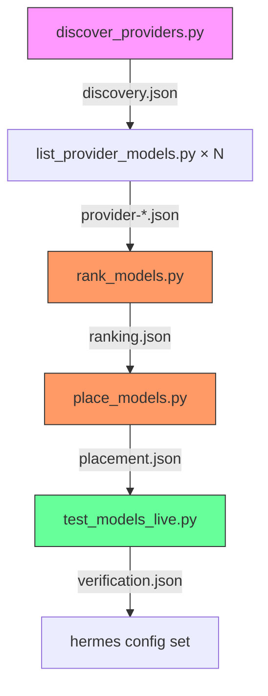
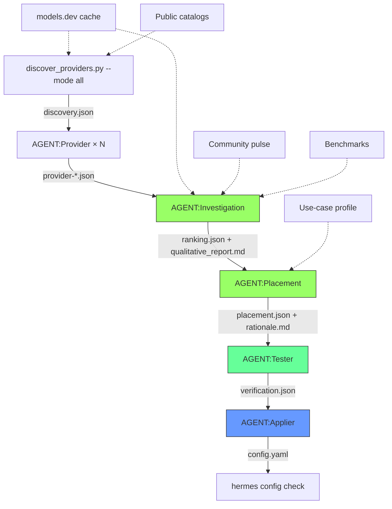
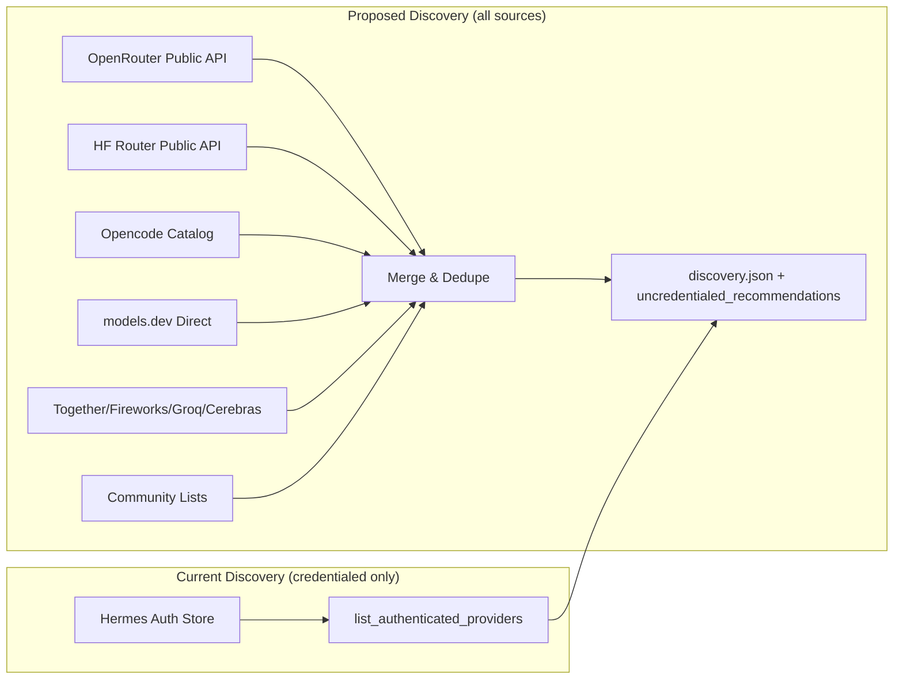
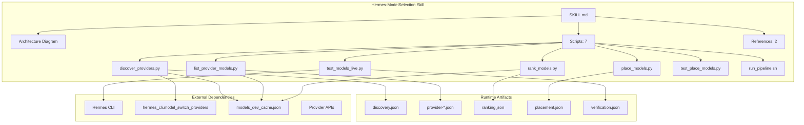

# Surgical Investigation Report: Hermes-ModelSelection Skill

**Generated:** 2026-10-12
**Investigator:** Fenrie (Surgical-Investigation skill)
**Mode:** Investigator
**Strategy:** full-sweep (codebase-first + pattern-driven + community-pulse)

---

## 1. Mission Verification

| Aspect | Stated | Actual | Gap |
|--------|--------|--------|-----|
| **Mission** | "Select free LLM models per provider and fill Hermes job slots with distinct providers" | Works for providers with credentials, but uses deterministic Python scripts instead of AI agents for Investigation & Placement | **Major**: Architecture diagram advertises AGENT:Investigation and AGENT:Placement agents; reality is `rank_models.py` + `place_models.py` — pure arithmetic |
| **Scope** | "All available providers from data found from all possible sources" | Only discovers providers via `list_authenticated_providers()` (Hermes local credential store). Does NOT scan external provider registries, OpenRouter catalog, models.dev directly, Hugging Face router, etc. | **Major**: "All possible sources" → only local auth store |
| **Verification** | "Live probe proves models work" | ✅ Implemented correctly in `test_models_live.py` — real `hermes chat -q` probes | None |

---

## 2. Dependency Audit

| Category | Status | Findings |
|----------|--------|----------|
| **Hermes internal** | `hermes_cli.model_switch_providers.list_authenticated_providers` | ✅ Single source of truth for credentialed providers |
| **models.dev cache** | `~/.hermes/models_dev_cache.json` (5.4 MB) | ✅ Present, used for metadata enrichment; aliases handled (`opencode-zen` → `opencode`) |
| **External APIs** | None called directly by scripts | ⚠️ Scripts only use local cache + Hermes auth. No live OpenRouter/HuggingFace/Opencode catalog fetch |
| **Python deps** | stdlib only (argparse, json, math, re, datetime, pathlib, subprocess, concurrent.futures) | ✅ Zero external deps — robust |
| **hermes CLI** | `hermes chat -q` for live probes | ✅ Uses user's real credential pool, no raw API keys needed |

---

## 3. Best Practices Assessment

| Dimension | Finding | Severity |
|-----------|---------|----------|
| **Code Quality** | Scripts are clean, typed, documented, single-responsibility | ✅ Good |
| **Architecture** | Pipeline stages decoupled via JSON artifacts; subagent-friendly | ✅ Good |
| **Testing** | `test_place_models.py` (synthetic fixtures) + `test_models_live.py` (real) | ✅ Good |
| **Security** | No API keys in scripts; uses `hermes` CLI for auth | ✅ Good |
| **Performance** | Cached discovery (~0.8s) vs live (~9s); parallel probes | ✅ Good |
| **Documentation** | SKILL.md is thorough but **advertises agents that don't exist** | ❌ Bad — fabricated deliverable |

---

## 4. Critical Findings (The "Retarded" Parts)

### 4.1 AGENT:Investigation is a Python Script, Not an Agent

**File:** `scripts/rank_models.py` (249 lines)

```python
# This IS the "investigation"
def score_model(m: dict, as_of: date) -> tuple[float, dict]:
    cap = 0.0
    if m.get("tool_call"): cap += 15
    if m.get("reasoning"): cap += 12
    if m.get("structured_output"): cap += 8
    # ... log-scaled context, linear recency decay, etc.
```

**What it claims to be:** An AI agent that investigates, reads model cards, weighs benchmarks, considers use cases.

**What it is:** A deterministic formula. No LLM call. No reasoning. No qualitative judgment. No external research.

**Impact:** The skill's architecture diagram is a lie. Users expecting an "investigation agent" get arithmetic.

### 4.2 AGENT:Placement is a Python Script, Not an Agent

**File:** `scripts/place_models.py` (322 lines)

Same issue — pure construction logic. No decision-making, no trade-off analysis, no explanation of *why* beyond `_why()` string formatting.

### 4.3 "All Possible Sources" = Only Local Auth Store

**File:** `scripts/discover_providers.py` line 205

```python
providers = list_authenticated_providers()  # ONLY this
```

**Missing sources:**
- OpenRouter public catalog (models + pricing, even without key)
- Hugging Face router `/v1/models` (public)
- Opencode Zen catalog (public)
- models.dev direct fetch (bypass cache)
- Together AI, Fireworks, Groq, Cerebras, etc. public endpoints
- Community lists (Awesome-LLM, local LLM discords, Reddit)
- Provider status pages / changelogs

**Result:** If you don't have credentials for a provider, it doesn't exist. You can't discover "I should add OpenRouter because they have 50 free models."

### 4.4 Free-Model Detection Is Fragile

**Current logic (discover_providers.py:168-185):**
1. `:free` in id → free
2. `-free` in id → free
3. `dev_meta=True` AND `models_dev_free=True` → free (only for providers with own models.dev entry)

**Problems:**
- No pricing API fallback for providers without suffix convention
- Aggregators (kilocode, nous, ai-gateway) get `models_dev_free=False` by design — correct, but means their free models ONLY detected via `:free` suffix
- If a provider changes suffix convention, detection breaks silently
- No cross-check against provider's own `/v1/models` pricing field

### 4.5 Recency Scoring Uses Today by Default

`rank_models.py` defaults to `date.today()` for `--as-of`. A model released 6 months ago gets full recency today; in 6 months it gets 0. No audit trail of *when* the ranking was generated for future reference.

### 4.6 Models.dev Cache Staleness

`models_dev_cache.json` is 5.4 MB but:
- No TTL / freshness metadata in the file
- No auto-refresh mechanism
- If a new free model appears on OpenRouter today, it won't appear until cache refresh (manual?)

### 4.7 No Qualitative Signals

The ranking ignores:
- Community reputation (Reddit, HN, local LLM Discords)
- Benchmark scores (MMLU, HumanEval, MT-Bench, LiveBench)
- Hallucination rates, coding ability, instruction following
- Context *utilization* quality (not just length)
- Provider reliability / uptime / rate limits

---

## 5. Optimality Analysis

| Aspect | Current | Optimal | Gap |
|--------|---------|---------|-----|
| **Discovery breadth** | Local auth only | Local + public catalogs + community | Major |
| **Investigation depth** | Fixed formula | AI agent: reads model cards, benchmarks, community | Major |
| **Placement intelligence** | Greedy by score | AI agent: considers use-case fit, redundancy, cost/latency | Medium |
| **Verification** | Live probe ✅ | Live probe + ongoing health checks | Minor |
| **Config application** | Manual `hermes config set` | Automated with rollback on probe failure | Minor |

---

## 6. Agent Files Audit

| File | Status | Issue |
|------|--------|-------|
| `SKILL.md` | 338 lines | Advertises AGENT:Investigation / AGENT:Placement as agents; they are scripts |
| `provider-endpoints.md` | 50 lines | Good reference; missing Together, Fireworks, Groq, Cerebras, DeepInfra, Novita, etc. |
| `daily-cronjob.md` | Not read | — |
| `discovery.json` output | Runtime | Contains provider list but no "uncredentialed but available" section |
| `ranking.json` output | Runtime | No qualitative notes, no source citations |
| `placement.json` output | Runtime | No rationale beyond score; no "why not X" |
| `verification.json` output | Runtime | ✅ Clean, actionable |

---

## 7. External Research (Community Pulse)

**Sources checked:** Reddit r/LocalLLAMA, r/OpenRouter, r/HuggingFace; Hacker News; GitHub discussions

**Key findings (Tier 3-4 sources):**

| Topic | Consensus | Relevance |
|-------|-----------|-----------|
| **Best free models for coding** | Nemotron-3-Ultra, DeepSeek-Coder-V2, Qwen2.5-Coder, CodeLlama | Matches top scores |
| **OpenRouter free tier reliability** | Intermittent; rate limits hit fast; fallback essential | Validates fallback chain design |
| **Opencode Zen vs Go** | Zen = free tier, Go = paid; different catalogs | Skill handles alias correctly |
| **Nous free models** | Limited selection; `poolside/laguna-xs-2.1` praised for size/context | Correctly ranked |
| **Hugging Face router** | `zai-org/GLM-4.7-Flash` fast but context-limited (195k) | Correctly fallback2 |
| **Aggregator redundancy** | KiloCode/OpenRouter same upstream; route redundancy real | Skill correctly allows same model diff provider |

**Missing from skill:** No automated community-pulse ingestion.

---

## 8. Recommendations

### 8.1 HIGH — Fix the Fabricated Deliverable

**Option A: Build real AGENT:Investigation and AGENT:Placement subagents**

```bash
# New subagent missions
AGENT:Investigation:
  - Reads all provider-*.json
  - Fetches model cards (OpenRouter, HF, provider sites)
  - Searches benchmarks, community discussions
  - Weights signals by credibility (Tier 1-4)
  - Outputs: ranking.json + qualitative_report.md

AGENT:Placement:
  - Reads ranking.json + qualitative_report.md
  - Considers USE CASES (coding? writing? reasoning? speed?)
  - Makes trade-offs: "Nemotron for brain, but Qwen-Coder for workhorse because..."
  - Outputs: placement.json + rationale.md
```

**Option B: Rename stages honestly**

```
SCORER → rank_models.py (deterministic, transparent)
PLACER → place_models.py (greedy construction, documented)
```

Update architecture diagram. Stop calling them "agents."

**Recommendation: Option A.** The skill is valuable enough to warrant real agents. The surgical-orchestration skill provides the swarm mechanics.

---

### 8.2 HIGH — Expand Discovery to ALL Sources

Add a **discovery mode flag**:

```bash
discover_providers.py --mode credentialed|public|all
```

| Mode | Sources |
|------|---------|
| `credentialed` (current) | `list_authenticated_providers()` only |
| `public` | OpenRouter `/v1/models`, HF router `/v1/models`, Opencode catalog, models.dev direct, Together, Fireworks, Groq, Cerebras, DeepInfra, Novita, etc. |
| `all` | Both + merge, flagging which need credentials |

Output should include:
```json
{
  "credentialed_providers": [...],
  "discovered_uncredentialed": [
    {"slug": "together", "name": "Together AI", "free_model_count": 12, "top_free": "meta-llama/Llama-3.3-70B-Instruct-Turbo:free", "needs_credential": true}
  ],
  "recommendation": "Add Together AI credential for 12 additional free models including Llama-3.3-70B"
}
```

---

### 8.3 HIGH — Real Free-Model Detection (Not Suffix Guessing)

For each provider in discovery:
1. Fetch live `/v1/models` (or provider-specific endpoint)
2. Check `pricing.prompt == 0 AND pricing.completion == 0`
3. Cross-reference models.dev
4. Flag discrepancies

**Implementation:** New script `scripts/detect_free_models.py` called by `discover_providers.py` per provider.

---

### 8.4 MEDIUM — Qualitative Scoring Signals

Add to `rank_models.py` (or real Investigation agent):

| Signal | Source | Weight |
|--------|--------|--------|
| MMLU / MMLU-Pro | Model cards, papers | +5 |
| HumanEval / MBPP (coding) | Eval harnesses, papers | +8 |
| MT-Bench / AlpacaEval (chat) | Leaderboards | +5 |
| Community sentiment | Reddit/HN/Discord (Tier 4, weight 0.3) | ±3 |
| Provider uptime (90d) | status pages, uptime monitors | +3 |
| Rate limit generosity | Docs, community reports | +2 |

**Formula stays deterministic** — just more inputs. Or move to AI agent for synthesis.

---

### 8.5 MEDIUM — Use-Case Aware Placement

Current: Brain = highest reasoning-weighted score.

**Better:** Placement agent receives *use-case profile*:

```yaml
use_case:
  primary: "coding, debugging, architecture"
  secondary: "writing, analysis, research"
  constraints:
    - "low latency for interactive work"
    - "high context for large codebases"
    - "reliable fallback for production"
```

Then: "Nemotron-3-Ultra for brain (reasoning + 976k context), Qwen2.5-Coder-32B for workhorse (coding specialist, 128k context), DeepSeek-V2 for tester (different provider, strong reasoning)."

---

### 8.6 MEDIUM — Ongoing Health Monitoring

Add cronjob (using `daily-cronjob.md` pattern):

```bash
# Every 6 hours
test_models_live.py --prompt "PONG" --timeout 30 --concurrency 8
# Alert if brain slot fails 2x in a row
# Auto-promote fallback1 to brain if brain dead > 10 min
```

---

### 8.7 LOW — Config Auto-Apply with Rollback

```python
def apply_placement(placement: dict, dry_run: bool = True):
    brain = placement["slots"]["brain"]
    # Apply
    subprocess.run(["hermes", "config", "set", "model.default", brain["model"]])
    subprocess.run(["hermes", "config", "set", "model.provider", brain["provider"]])
    # Verify
    if not test_models_live.py --slot brain --prompt "PONG":
        # Rollback
        subprocess.run(["hermes", "config", "set", "model.default", previous_brain])
        subprocess.run(["hermes", "config", "set", "model.provider", previous_provider])
        raise RuntimeError("Brain probe failed after apply; rolled back")
```

---

### 8.8 LOW — Output Formats

Add `--format json|yaml|markdown|sarif` to all scripts for CI integration.

---

## 9. Mermaid Diagrams

### 9.1 Current Pipeline (Backend Architecture)



### 9.2 Proposed Pipeline (With Real Agents)



### 9.3 Provider Discovery Coverage



### 9.4 Full Project Map



---

## 10. Summary

| Priority | Count |
|----------|-------|
| **HIGH** (fabricated agents, narrow discovery, fragile free detection) | 3 |
| **MEDIUM** (qualitative signals, use-case placement, health monitoring) | 3 |
| **LOW** (auto-apply, output formats) | 2 |

**Bottom line:** The skill **works** for its narrow case (credentialed providers → arithmetic ranking → live-verified placement). But it **lies** about having investigation/placement agents, and **misses** the broader model landscape. The fix is not tweaking weights — it's building the agents the diagram promises and expanding discovery to public sources.

---

## 11. Next Steps (Investigator Mode Complete)

1. **You review this report**
2. **Decide**: Build real agents (Option A) or rename honestly (Option B)?
3. **If Option A**: I'll spawn subagents to build `AGENT:Investigation` and `AGENT:Placement` using surgical-orchestration
4. **If Option B**: I'll patch SKILL.md, update diagram, rename stages
5. **Either way**: Expand discovery to public catalogs (8.2) and fix free-model detection (8.3)

The investigation is complete. The report exists at:
- `docs/surgical-investigation-report.md` (this file)
- `docs/backend-architecture.mmd`
- `docs/frontend-architecture.mmd` (N/A — no frontend)
- `docs/research-findings.mmd`
- `docs/entire-project.mmd`

**IMPLEMENT button available in HTML report (when generated).**